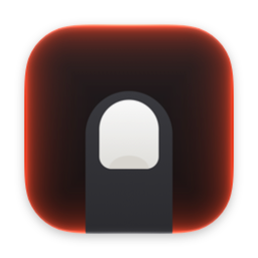

  

<h1 align="center">NailBiteMenu</h1>

  A <b>menu bar app</b> that uses your Mac’s camera to detect nail-biting in real time, locally and privately.
   
  <a href="https://github.com/killian31/NailBiteMenu/releases/latest/download/NailBiteMenu.dmg">
    ⬇️ <b>Download for macOS (DMG)</b>
  </a>

## Table of Contents

- [Open Source](#open-source)
- [Installation](#installation)
- [Usage](#usage)
  - [Sensitivity](#sensitivity)
- [Alerts](#alerts)
- [Privacy](#privacy)
- [Requirements](#requirements)
- [Feedback](#feedback)

## Open Source

The full **NailBiteMenu macOS app**, including its Swift source and Core ML models, is now **open source**.
You can explore, build, or contribute to it right here:

📂 [`/app`](./app) → contains all app source code and models

💡 Pull requests and issues are welcome!

## Installation

1. **Download** the latest release:  
   👉 [NailBiteMenu.dmg](https://github.com/killian31/NailBiteMenu/releases/latest/download/NailBiteMenu.dmg)

2. **Open** the DMG and **drag** `NailBiteMenu.app` into your **Applications** folder.

3. Open it and allow camera access when macOS asks. The app is signed with a Developer ID and notarized by Apple.

4. NailBiteMenu now runs quietly from your **menu bar**.

> **Tip:** If your menu bar is crowded, macOS may hide the icon behind the chevron (⌃). Drag it out from Control Center to pin it.

## Usage

NailBite runs from your **menu bar**. The main window has three sections:

- **Today**: how long you've been bite-free, today's and the last 7 days' episodes, your bite-free streak, today by hour, the apps where biting happened, and recent episodes.
- **Insights**: the episode count and its change against the period before, episodes per day with a 7-day average, a weekday × hour heatmap, average episode length, bite-free days, and top trigger apps over 7 days, 30 days, 90 days, or all time.
- **Settings**: alerts, sensitivity, theme (System, Light, Dark), and data reset.

Close the window and monitoring keeps running. The menu bar panel shows the bite-free timer, a live signal meter with your alert threshold, and your episode count for today, this week or this month next to the period before, with buttons to pause or open the app.

Detections a few seconds apart are grouped into one **episode**. Streaks and bite-free days only count days the app was monitoring. Everything is stored locally.

### Sensitivity

**Settings › Detection** has a slider from Relaxed to Strict, 75 by default. It sets how sure the model must be before a frame counts as biting:

| Setting | Behavior |
|-----------|----------|
| **Lower** | Catches bites a little earlier, with more false alerts from hand-to-mouth gestures |
| **75 (default)** | Recommended everyday setting |
| **Higher** | Fewer false alerts, but quick bites may be missed |

Tune it based on lighting, distance to the camera, and how early you want alerts. The live signal meter in the menu bar panel shows the model's score next to your setting.

## Alerts

When biting starts:

1. **The screen edges light up.** Red light comes in from the edges of every screen within a fraction of a second, with a short ping and a "Hands down" label naming the app you're in. It stays on while you keep biting and fades about a second after your hands come down. It never takes focus.
2. **A 30-second reset**, once per episode, if you keep biting. The screen dims and a countdown paces your breathing, four seconds in and four out, while the red fades. This is the competing-response step of habit reversal training.

The glow, the label, the sound and the reset can each be turned off in Settings, and **Preview Alert** and **Preview Reset** let you try them.

## Privacy

- All processing happens **on-device**. The camera feed never leaves your Mac.
- The app runs in the App Sandbox **without network access**: no analytics, no cloud services.
- You stay in control — pause monitoring any time.

## Requirements

- macOS **15.6 Sequoia** or later  
- Camera permission (requested on first use)

## Feedback

Spotted a bug? Have an idea?

→ [Open an issue](https://github.com/killian31/NailBiteMenu/issues)

  Made on macOS • © 2025 <a href="https://github.com/killian31">killian31</a>

