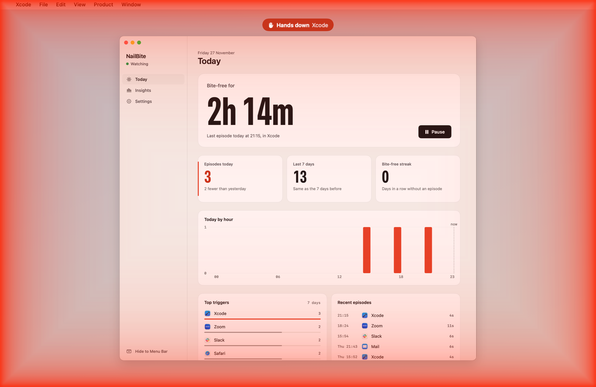

# Proposal C: Signal

## Direction

- **Product.** A menu bar app that catches nail-biting through the Mac's camera, on device, and shows when and in which app it happens.
- **Character.** Blunt, warm, exact.
- **World.** Signal lamps and scoreboards: one red lamp that means one thing, numbers you can read from across the room, and the small green light next to the Mac's camera.
- **Moments.** The edge glow, and the Insights chart where grey daily bars sit under one vermilion trend line. The giant bite-free clock is the quiet third.
- **Signature.** A short vermilion bar on the leading edge of anything that counts bites. It echoes the glow, which comes in from the edges of the screen.

## Palette

Monochrome, plus one color with one meaning. Vermilion only ever says "biting happened": the alert, today's count, the bars and cells in the charts, the top trigger app. Everything you can press, and every number that is good news, is ink. The Slate Indigo, Pumpkin Spice and Frozen Water roles are gone.

| Role | Light | Dark | Use |
| --- | --- | --- | --- |
| Background | `#F4F4F1` | `#0F0F10` | Window, popover |
| Surface | `#FFFFFF` | `#18181A` | Cards |
| Raised | `#EDEDEA` | `#232326` | Selected row, secondary buttons, empty heatmap cells |
| Hairline | ink at 9% | ink at 9% | Card borders, dividers, chart grid |
| Text | `#151517` | `#F2F2F0` | Primary text, ink buttons |
| Text secondary | `#4A4A4F` | `#A1A1A6` | Labels |
| Text tertiary | `#6B6B6B` | `#8E8E93` | Meta, axis labels (4.8:1 and 5.5:1) |
| Signal | `#E5432A` | `#FF5A3D` | Bars, cells, the signature bar |
| Signal text | `#C8341C` | `#FF5A3D` | Counts set in vermilion (5.3:1 and 5.8:1) |
| Live | `#1E9E4A` | `#30D158` | The camera-on dot, nothing else |
| Glow | P3 `0.95 0.25 0.14` | same | The alert, in Display P3 so it is richer than sRGB on Mac screens |

The AccentColor asset (toggles, slider, system dialogs) moves to `#C8341C` / `#D93A20`, both readable under white.

## Type

- **Figures:** SF Pro Compressed, semibold, tabular (`Font.dsFigure`). 120 pt for the bite-free clock, 132 pt for the Insights count, 52 pt in tiles, 64 pt in the popover. Compressed lets a number be huge without being wide, which is what a scoreboard does.
- **Meta:** SF Mono 11 medium for axis labels, counts in lists, timestamps and the live signal readout.
- **Interface:** SF Pro 13 regular and semibold. Page titles 26 semibold with a quiet line of context above ("Friday 27 November", "Last 30 days").
- No new fonts ship with the app. All three faces are system fonts.

## Surfaces

**Popover** (`popover-today-*.png`, `popover-week-*.png`). Built so the window is only needed for the deep dive. The bite-free clock leads at 64 pt. Under it, a live signal meter replaces the old confidence ring: a thin bar with a notch at your sensitivity setting, grey below it and vermilion once it crosses. Then the stats at a glance, with a Today / Week / Month switch: the count (vermilion when above zero), how it moved ("2 fewer than yesterday", "Same as the week before", vermilion when it got worse), a small bar chart where only the current hour or day carries the signal, and three figures: longest gap, yesterday and streak for Today; per day, best day and worst day for Week and Month. Pause is the one ink button, next to Today, Insights and Settings. The header carries the green camera dot. A live camera preview was left out: it would need a second consumer on the capture session, which is outside this proposal.

**Main window** (`today-*.png`). A custom sidebar replaces `NavigationSplitView`: wordmark, live status, three rows (⌘1 to ⌘3) and Hide to Menu Bar at the bottom. The window uses a hidden title bar so the content runs to the top.

**Today.** One hero card with the bite-free clock at 120 pt and Pause as an ink button, then three number tiles (the one counting bites carries the signature bar), today by hour in vermilion with a "now" rule, top triggers as a ranked list with thin share bars (only the first is vermilion), and recent episodes with mono timestamps.

**Insights** (`insights-*.png`) is the hero screen. The period's episode count is set at 132 pt next to its change ("48% fewer than the period before", in ink when it is good news and vermilion when it is not), with per day, typical length and bite-free days at 44 pt beside it. Below, the main chart: neutral bars for each day, a 7-day rolling average as the one vermilion line with its current value labeled at the end, and black dots on monitored days with no episode. Ranges over 120 days switch to weekly bars and a 4-week average. Under it, the weekday by hour heatmap (vermilion by intensity, with "Most often Mon around 14:00" in the header) sits next to the trigger apps list.

**Settings** (`settings-*.png`). Still the native grouped Form, now led by the Alert section: **Preview Alert** and **Preview Reset** run the real path, sound included, so the alert can be tested and screenshotted without biting. Each part of the alert can be turned off on its own: Edge glow, the "Hands down" label, and Sound (the old "Mute alert sounds", now phrased as the thing you get). Deleting history names what goes: "All 291 episodes from 80 days will be deleted" (with your real numbers).

## The alert

**Level 1, edge glow** (`alert-*.png`, `alert.mp4`, `alert-frames.png`). Vermilion light hits every edge of every screen at once, following the display's rounded corners, with a faint wash over the whole screen. Detection is getting faster (about 0.3 s on the `faster-trigger` branch), so the alert must not spend that gain on a fade: the edges are unmistakable on the first frames, and only the inward swell and the fade-out are slow.

| Phase | Time | Curve |
| --- | --- | --- |
| Edges light | 0 to 90 ms | ease-out cubic (41% on the first 60 Hz frame) |
| Deep light swells inward | 0 to 500 ms | ease-out cubic |
| Hold, settling to 88% | 90 ms to 1.1 s | ease-in-out |
| Draw back to the edges | 1.1 s to 1.9 s | ease-in-out |

From the trigger, the glow starts 30 ms later (the shared lead for sound and picture) and is at full edge strength by about 120 ms.

The glow is five layers, all animated by opacity only: a bright rim (falloff about 1% of the screen's short side), a body (4%), deep light (15%), a 5% wash, and the caption. The deep light swells in after the edges and retreats before them, so the light visibly travels inward and back out. The images are computed once per screen at a quarter of the point size with an exponential falloff and scaled up, which costs nothing visible because they are pure gradients.

A vermilion tag, "Hands down" plus the frontmost app, drops 8 pt into place under the menu bar on the screen with the pointer. VoiceOver announces the same text.

`alert-frames.png` reads left to right, top to bottom: 0, 33, 67, 100, 200, 500, 1100, 1500 and 1900 ms. `alert.mp4` has the chime muxed in at the first frame.

**Sound.** A dry E6 ping with a soft octave (2 ms attack, 110 ms decay) for level 1, and two notes falling a fourth for level 2. Both are synthesized as PCM at launch, so there is no file to ship or decode. Sync: the panels and the caption are built first; only then is one start time fixed, 30 ms out. The sound is scheduled for it with `AVAudioPlayer.play(atTime:)` and the glow's keyframes get it as their Core Animation `beginTime`, so both start on the same frame. The panels are built at launch and rebuilt when displays change, so the first alert is on time too.

**Level 2, the reset** (`reset-prompt-*.png`, `reset-breathing-*.png`). The glow comes up to 80% in 120 ms and the screen dims to 42%. A card offers "Still biting" in 64 pt compressed type, Not Now and Start Reset. During the reset the card shows a 120 pt countdown, "Breathe in" or "Breathe out", and a progress bar. The glow paces the breathing: it swells for 4 s and settles for 4 s, and each breath is a little dimmer than the last, so the red drains away as the timer runs out. "Done" holds for 2 s and everything fades.

**Requirements**

- The glow panels are nonactivating, refuse key and main status, ignore the mouse, and join every Space at screen saver level with `fullScreenAuxiliary`, so they show over full-screen apps.
- The reset card is never made key when it appears, unless VoiceOver or Full Keyboard Access is on (then it takes key, still without activating the app, and waits 60 s instead of 20 s). Clicking it makes it key, after which Return and Esc work. When it closes, keyboard focus goes back to the app that had it.
- The card sits centered in a fixed transparent frame, so its phases change height without drifting. Clicks on the transparent margin fall through.
- Reduce Motion: the glow keeps one shape and only fades (no inward travel) over 160 ms, the caption doesn't move, the reset glow steps down linearly instead of breathing, the copy drops "breathe with the edges", and the card and its phases fade without moving.
- Sound, edge glow and label each follow their own toggle.
- "Close NailBite App" (⌘Q) no longer closes the alert panels mid-alert.

## Notes

- Liquid Glass is no longer used. Buttons are two custom styles (ink and quiet) with a 0.97 press scale, so they look the same on macOS 15 and 26.
- The screenshots come from `DesignShots.swift`, a Debug-only renderer that draws every surface from mock data (95 days, improving) and composites the glow over a mock desktop. Run a Debug build with `-NBDesignShots YES -preferences.startMonitoringOnLaunch NO`. It never touches the real history. In the settings shots the switches look inactive because the offscreen window is not key.
- Detection, the model and the camera pipeline are unchanged. `MonitorViewModel` only gained a Debug flag that shows the watching state without opening the camera.
- The app icon is unchanged.
